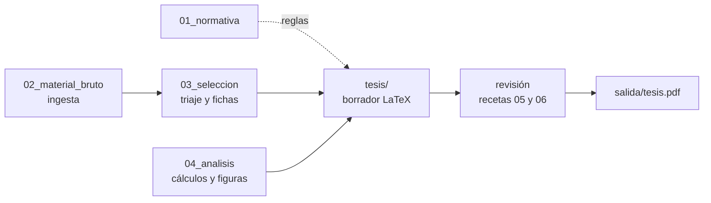

# Tesis — Marco Briones

Mi tesis de Ingeniería Civil, escrita en LaTeX y organizada como un
proyecto de **edición de video**: el material bruto entra por un lado, se
selecciona, se trabaja y sale un único *master* (el PDF).

Está pensada para que **cualquier IA** (Claude, ChatGPT, Gemini,
NotebookLM...) pueda leer el repositorio y continuar el trabajo con todo el
contexto. Las IA empiezan por [`AGENTS.md`](AGENTS.md).

## Estructura

```
Tesis/
├── AGENTS.md              ← Instrucciones para cualquier IA (empieza aquí)
├── 00_proyecto/           ← "Preproducción": la memoria del proyecto
│   ├── CONTEXTO.md        ←   de qué trata la tesis (resumen maestro)
│   ├── ESTADO.md          ←   en qué va y qué sigue (handoff entre sesiones)
│   ├── DECISIONES.md      ←   decisiones tomadas y por qué
│   ├── PLAN.md            ←   cronograma e hitos
│   ├── GLOSARIO.md        ←   términos, símbolos y abreviaturas
│   └── BITACORA.md        ←   registro de cada sesión de trabajo
├── 01_normativa/          ← Instrucciones de formato de la universidad
│   ├── originales/        ←   PDFs/Word tal como te los dieron (no se tocan)
│   └── REGLAS_FORMATO.md  ←   las reglas extraídas, una por línea
├── 02_material_bruto/     ← "Rushes": todo lo que ya tienes, bueno y malo (no se tocan)
├── 03_seleccion/          ← "Logging": triaje del material, fichas de lectura, notas
├── 04_analisis/           ← Cálculos en Python, datos y scripts que generan figuras
├── tesis/                 ← EL MASTER: solo el LaTeX final
│   ├── main.tex
│   ├── config/            ←   formato, paquetes y comandos
│   ├── portada/  preliminares/  capitulos/  anexos/
│   ├── figuras/  tablas/
│   └── bib/referencias.bib
├── herramientas/          ← Scripts y "lenguajes especiales"
│   ├── HERRAMIENTAS.md    ←   catálogo: investigación, ingeniería, diseño, matemática, LaTeX
│   └── recetas/           ←   prompts reutilizables para la IA
└── salida/                ← PDFs generados (no se sube; lo genera GitHub)
```

## Flujo de trabajo



## Cómo empezar (primeros pasos)

1. **Sube la normativa** de la universidad a `01_normativa/originales/`.
2. **Sube todo tu material previo** a `02_material_bruto/` (borradores a `borradores_previos/`, papers a `papers/`, datos a `datos_crudos/`).
3. **Completa** `00_proyecto/CONTEXTO.md` (aunque sea a medias).
4. Abre una IA y pídele: *"Lee AGENTS.md y aplica la receta 01_extraer_normativa"*; luego la receta 02 para cada borrador.

Para subir archivos sin usar la terminal: en GitHub, entra a la carpeta → **Add file → Upload files**.

## Cómo trabajar con una IA

| Tipo de IA | Cómo darle el contexto |
|---|---|
| Con acceso al repositorio (Claude Code, Codex, Cursor, Copilot) | Solo dile: *"Lee AGENTS.md y aplica la receta 00_inicio_sesion"* |
| Chat web (ChatGPT, Gemini, Claude.ai) | Ejecuta `make contexto` y sube `salida/contexto_completo.md` |
| NotebookLM | Sube `salida/contexto_completo.md` + los PDFs de `02_material_bruto/papers/` |

Al terminar, pide siempre la receta `08_cierre_sesion` para que quede
registrado qué se hizo.

## Compilar

**En GitHub (sin instalar nada):** cada `push` compila la tesis. Ve a la
pestaña **Actions** → última ejecución → descarga el artefacto **tesis-pdf**.

**En tu computador** (requiere TeX Live o MiKTeX, con `latexmk` y `biber`):

```bash
make pdf
```

Otros comandos: `make ayuda`.

## Herramientas

Ver [`herramientas/HERRAMIENTAS.md`](herramientas/HERRAMIENTAS.md):
catálogo de los "lenguajes especiales" para investigación, ingeniería,
diseño, matemática y LaTeX, con su equivalente en edición de video.
