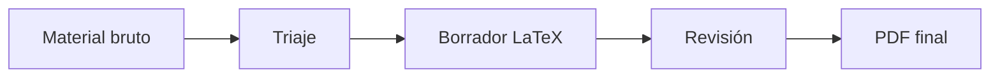

# HERRAMIENTAS — Los "lenguajes especiales" de la tesis

En edición de video no se hace todo a mano en el programa: se usa **FFmpeg**
para convertir y cortar, **EDL/XML** para describir el montaje, **LUTs** para
el color, **proxies** para trabajar liviano. Todo eso es texto o código que
se puede repetir.

Una tesis se puede trabajar igual. Esta es la tabla de equivalencias:

| En edición de video | En la tesis | Para qué |
|---|---|---|
| Proyecto de Premiere / Resolve | `tesis/main.tex` | Arma la pieza final desde las partes |
| Timeline (EDL / XML) | `\include{capitulos/...}` | Orden de los capítulos |
| FFmpeg (render por línea de comandos) | `latexmk` (`make pdf`) | Genera el PDF sin intervención |
| Cola de render (*render queue*) | `Makefile` + GitHub Actions | Todo se compila solo, cada vez |
| Transcodificar formatos | **Pandoc** (`make convertir`) | Word / Markdown / HTML ↔ LaTeX |
| LUT / preset de color | `config/formato.tex`, `estilo_tesis.mplstyle` | Un mismo "look" en todo el documento |
| Motion graphics / plantillas de títulos | **TikZ**, **PGFPlots** | Diagramas y gráficos hechos con código |
| VFX con script (After Effects expressions) | **Python** (NumPy, SymPy, matplotlib) | Cálculos y figuras regenerables |
| Metadatos / *logging* de clips | Fichas de lectura + **BibLaTeX** | Saber qué dice cada fuente y citarla bien |
| Control de calidad (QC) | **chktex**, `verificar_citas.py`, LTeX | Detectar errores antes de entregar |
| Versiones del corte (v1, v2, *final_final*) | **Git** + etiquetas + **latexdiff** | Historial y comparación de versiones |
| Proxy liviano para enviar | `make contexto` | Todo el contexto en un archivo para otra IA |

A continuación, el catálogo por área. ⭐ = recomendado empezar por aquí.

---

## 1. Investigación (buscar, leer, citar)

### Buscar fuentes

| Herramienta | Qué hace | Cuándo usarla |
|---|---|---|
| ⭐ **Google Scholar** | Buscador académico general | Primera búsqueda; ver "citado por" |
| ⭐ **Scopus** / **Web of Science** | Bases indexadas de calidad (acceso por la universidad) | Fuentes "serias" para el marco teórico |
| **SciELO**, **Redalyc**, **Dialnet** | Revistas latinoamericanas y en español | Contexto regional, normativa local |
| **Repositorios de tesis** (de tu universidad y otras) | Tesis anteriores | Ver estructura y alcance de otras memorias |
| **OpenAlex** / **Semantic Scholar** | Bases abiertas con API | Búsquedas automatizadas, redes de citas |
| **ResearchRabbit**, **Connected Papers**, **Litmaps** | Mapas visuales de papers relacionados | Encontrar lo que te falta a partir de 1–2 papers clave |
| **Elicit**, **Consensus**, **Scite** | IA que busca y resume papers | Exploración rápida (siempre verificar en el paper original) |
| Normas técnicas | Sitio oficial del organismo normalizador de tu país, ACI, ASCE, Eurocódigos, AASHTO | Valores de diseño: **siempre de la versión vigente oficial** |

**Lenguaje de búsqueda (operadores booleanos)** — funciona en Scopus, WoS y Scholar:

```text
("hormigón armado" OR "reinforced concrete") AND (sismo* OR seismic) AND NOT puente*
TITLE-ABS-KEY("pavement" AND "recycled aggregate")   ← sintaxis Scopus
```

- `"..."` frase exacta · `OR` sinónimos · `AND` obligatorio · `NOT` excluir · `*` raíz (sism* → sismo, sísmico...).
- Guarda cada ecuación de búsqueda en `03_seleccion/notas/busquedas.md` con fecha y nº de resultados
  (así la búsqueda es reproducible; es lo que pide el método **PRISMA** si haces revisión sistemática).

### Gestionar referencias

| Herramienta | Qué hace |
|---|---|
| ⭐ **Zotero** + extensión **Better BibTeX** | Guarda papers con un clic desde el navegador, genera claves estables y exporta automáticamente a `tesis/bib/referencias.bib` |
| ⭐ `herramientas/doi2bib.sh` | Convierte un DOI en entrada BibTeX real (desde doi.org) |
| **BibLaTeX + Biber** | El "lenguaje" de citas en LaTeX: `\parencite{}`, `\textcite{}` |
| `verificar_citas.py` (`make revisar`) | Detecta citas que no están en el `.bib` (posibles inventos de IA) |

```bash
bash herramientas/doi2bib.sh 10.1016/j.engstruct.2020.110000 >> tesis/bib/referencias.bib
```

### Leer y sintetizar

- **Fichas de lectura** (`03_seleccion/fichas_lectura/`): una por fuente, en Markdown. Es tu "NotebookLM" propio.
- **NotebookLM**: sube los PDFs de `02_material_bruto/papers/` + `salida/contexto_completo.md` para preguntar en lenguaje natural.
- **Matriz de síntesis**: tabla autor × tema en `03_seleccion/notas/` para escribir el estado del arte comparando, no resumiendo uno por uno.

---

## 2. Ingeniería (cálculo, modelación, datos)

| Herramienta | Qué hace | Lenguaje |
|---|---|---|
| ⭐ **Python + NumPy / SciPy / pandas** | Cálculo numérico, datos, estadística | Python |
| ⭐ **Jupyter** | Cuadernos para explorar cálculos paso a paso | Python |
| ⭐ **handcalcs** | Escribe un cálculo en Python y lo muestra como **memoria de cálculo en LaTeX** (fórmula → valores → resultado) | Python → LaTeX |
| **Pint** / **forallpeople** | Cálculos con unidades (evita errores kN vs kgf) | Python |
| **OpenSeesPy** | Análisis estructural no lineal / sísmico | Python |
| **FEniCS**, **Gmsh** | Elementos finitos y mallado | Python |
| **pandas → LaTeX** | `df.to_latex()` para tablas de resultados | Python → LaTeX |
| SAP2000 / ETABS / HEC-RAS / Plaxis / etc. | Software comercial | Exportar resultados a CSV → `04_analisis/datos/` |
| **Excel** | Válido, pero guarda una copia CSV para que sea reproducible | — |

**Regla:** los números de la tesis salen de un script, nunca se copian a mano
(ver `04_analisis/README.md`).

---

## 3. Diseño (figuras, diagramas, aspecto visual)

| Herramienta | Qué hace | Formato |
|---|---|---|
| ⭐ **TikZ** | Diagramas dibujados con código dentro de LaTeX (mismas fuentes que el texto) | `.tex` |
| ⭐ **PGFPlots** | Gráficos con código LaTeX | `.tex` |
| **stanli** (paquete LaTeX) | Esquemas de estática: apoyos, cargas, vigas, nudos | `.tex` |
| ⭐ **matplotlib** + `estilo_tesis.mplstyle` | Gráficos desde Python con un estilo único | `.pdf` vectorial |
| **draw.io / diagrams.net** | Diagramas a mano alzada; el archivo `.drawio` es texto y va en Git | `.drawio` → `.pdf` |
| **Mermaid** | Diagramas de flujo escritos en texto; GitHub los muestra directo en los `.md` | `.md` |
| **Inkscape** | Retocar figuras vectoriales (SVG → PDF) | `.svg` |
| **ColorBrewer**, **viridis** | Paletas legibles e imprimibles en blanco y negro | — |
| **QGIS** | Mapas de ubicación del caso de estudio | `.pdf` |

Ejemplo Mermaid (se ve como diagrama en GitHub):



Buenas prácticas: figuras en **PDF vectorial**; mismo tamaño de letra que
el texto; unidades en los ejes `[kN]`; nunca capturas de pantalla de gráficos.

---

## 4. Matemática

| Herramienta | Qué hace |
|---|---|
| ⭐ **amsmath / mathtools** | Ecuaciones alineadas, casos, matrices |
| ⭐ **siunitx** | Números y unidades: `\qty{25}{\mega\pascal}` → 25 MPa con formato correcto |
| ⭐ **SymPy** | Álgebra simbólica en Python; `sp.latex(expr)` entrega la ecuación lista para LaTeX (ver `ejemplo_figura.py`) |
| **Mathpix Snip** | Foto o captura de una ecuación → código LaTeX |
| **Detexify** | Dibujas un símbolo → te dice el comando LaTeX |
| **WolframAlpha** | Verificar integrales, derivadas, soluciones |
| **GeoGebra** | Visualizar geometría y funciones |

Verificación: revisar **consistencia dimensional** (Pint lo hace solo),
casos límite (¿qué pasa si x→0?) y que cada símbolo esté en `GLOSARIO.md`.

---

## 5. LaTeX (escritura y control de calidad)

| Herramienta | Qué hace | Comando |
|---|---|---|
| ⭐ **latexmk** | Compila todo (LaTeX + Biber + reintentos) | `make pdf`, `make vigilar` |
| ⭐ **VS Code + LaTeX Workshop** | Editor con vista previa del PDF y autocompletado | (extensiones recomendadas en `.vscode/`) |
| ⭐ **LTeX+** (LanguageTool) | Corrector de ortografía y gramática en español dentro de VS Code | — |
| **chktex** | Detecta errores típicos de LaTeX | `make revisar` |
| **texcount** | Cuenta palabras por capítulo | `make contar` |
| **latexindent** | Ordena la indentación del código | `latexindent -w archivo.tex` |
| **latexdiff** | PDF con cambios marcados entre versiones (para el profesor guía) | `make diff DESDE=v0.1` |
| **Pandoc** | Convierte Word/Markdown ↔ LaTeX | `make convertir ARCHIVO=...` |
| **Tables Generator** (web) | Tabla visual → código LaTeX | — |
| **Overleaf** | Editor LaTeX en línea; con plan pagado se sincroniza con GitHub | — |

---

## 6. Trabajo con IA (continuidad entre herramientas)

| Herramienta | Qué hace |
|---|---|
| ⭐ `AGENTS.md` | Instrucciones estándar que leen Claude Code, Codex, Cursor, Copilot, etc. |
| `CLAUDE.md` | Apunta a `AGENTS.md` (Claude Code lo lee automáticamente) |
| ⭐ `make contexto` | Junta todo en `salida/contexto_completo.md` para IAs sin acceso al repo (ChatGPT web, Gemini, NotebookLM) |
| ⭐ `herramientas/recetas/` | Prompts probados para tareas repetidas |
| **Gitingest** / **Repomix** | Alternativas externas para empaquetar el repo entero en texto |
| `00_proyecto/ESTADO.md` + `BITACORA.md` | La "memoria" entre sesiones |
